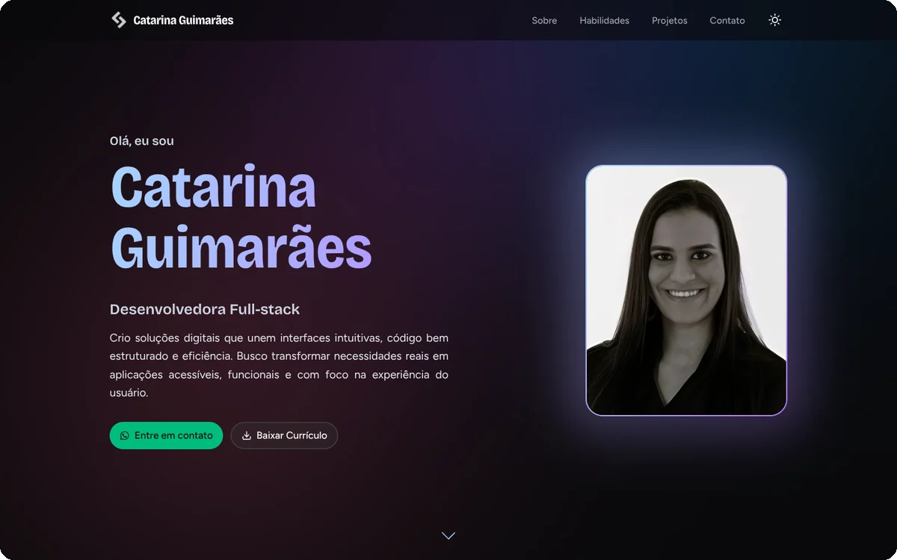
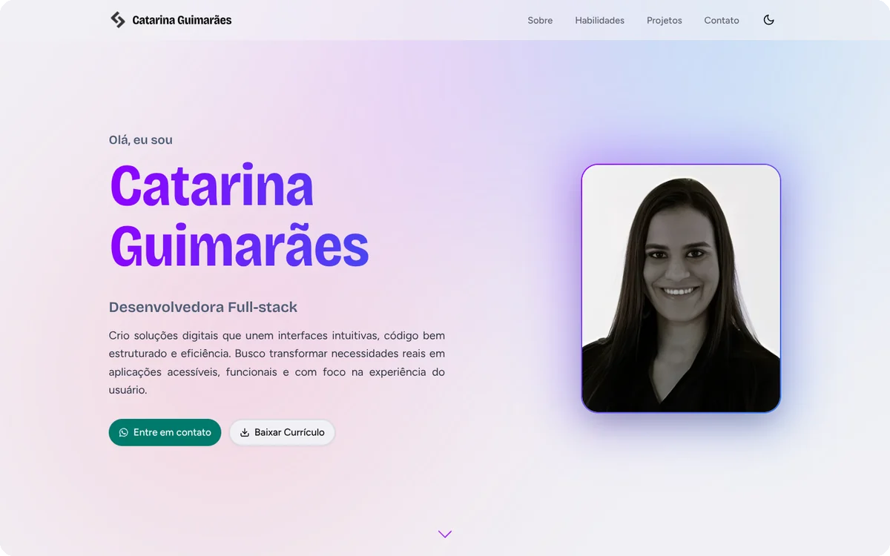
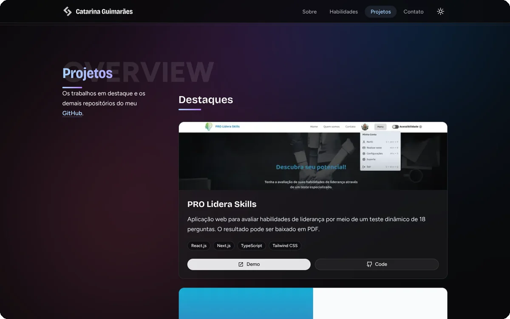
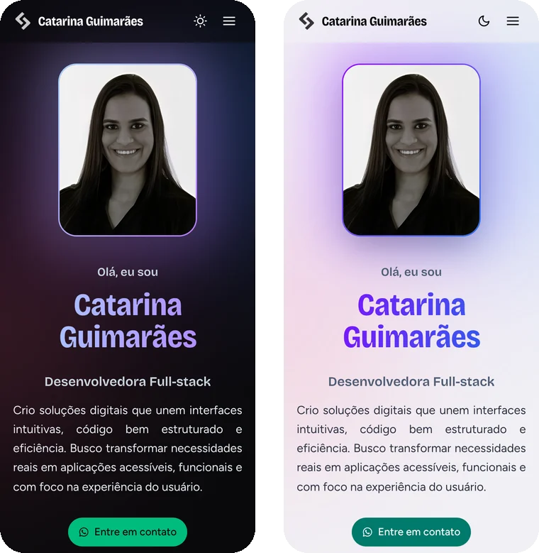

<div align="center">

# Catarina Guimarães

### Desenvolvedora Full-stack

Meu portfólio pessoal: quem eu sou, o que sei fazer e os projetos que já construí.

[](https://vercel.com/catarinaguimas-projects/portifolio)
<br/>
[](https://portifolio-catarina-guimaraes.vercel.app/)

<br />



<br />
<br />

[Sobre o projeto](#-sobre-o-projeto) · [Preview](#-preview) · [Tecnologias](#-tecnologias) · [Estrutura](#-estrutura-do-projeto) · [Como rodar](#-como-rodar) · [Contato](#-contato)

</div>

---

## ✨ Sobre o projeto

Um site de uma página só, pensado para apresentar meu trabalho de forma simples e direta. Foi construído com foco em **performance**, **acessibilidade** e um visual moderno, com tema claro e escuro.

- 🌗 **Tema claro e escuro**: acompanha o sistema e pode ser trocado no header.
- 📱 **Responsivo**: funciona do celular ao desktop, com menu próprio para telas pequenas.
- 📌 **Títulos fixos**: o título de cada seção acompanha a rolagem da página.
- 🗂️ **Projetos**: dois destaques com demo e código, e um **carrossel** com os demais repositórios do GitHub, buscados no servidor com cache de 1 hora.
- 💬 **WhatsApp seguro**: o botão de contato passa por uma rota de API, e o número fica só no servidor.
- 📄 **Currículo**: download direto em PDF.
- ♿ **Acessibilidade**: link para pular ao conteúdo, foco visível no teclado e respeito à preferência por menos movimento.
- 🔗 **Prévia ao compartilhar**: a imagem que aparece no WhatsApp e no LinkedIn é gerada por código (Open Graph).

---

## 📸 Preview

<table>
  <tr>
    <th align="center">Tema escuro</th>
    <th align="center">Tema claro</th>
  </tr>
  <tr>
    <td></td>
    <td></td>
  </tr>
</table>

<table>
  <tr>
    <th align="center">Projetos em destaque</th>
    <th align="center">No celular</th>
  </tr>
  <tr>
    <td valign="top"></td>
    <td valign="top" align="center"></td>
  </tr>
</table>

---

## 🧰 Tecnologias

<p>
 
</p>

| Camada | O que uso |
| --- | --- |
| **Framework** | [Next.js 16.3.8](https://nextjs.org/) (App Router) e [React 19](https://react.dev/) |
| **Linguagem** | [TypeScript](https://www.typescriptlang.org/) |
| **Estilo** | [Tailwind CSS 4](https://tailwindcss.com/), componentes no estilo [shadcn/ui](https://ui.shadcn.com/) (Radix UI) e tw-animate-css |
| **Animações** | [Framer Motion](https://www.framer.com/motion/) |
| **Carrossel** | [Embla Carousel](https://www.embla-carousel.com/) com autoplay |
| **Tema e ícones** | [next-themes](https://github.com/pacocoursey/next-themes), [react-icons](https://react-icons.github.io/react-icons/) e [lucide](https://lucide.dev/) |
| **Fontes** | Bricolage Grotesque (títulos) e Figtree (texto), hospedadas no próprio projeto |
| **Dados** | [API REST do GitHub](https://docs.github.com/en/rest), consultada no servidor |
| **Qualidade** | [ESLint](https://eslint.org/) |
| **Deploy** | [Vercel](https://vercel.com) |

---

## 📂 Estrutura do projeto

```text
.
├── docs/screenshots/            # imagens usadas neste README
├── public/
│   ├── docs/curriculum.pdf      # currículo em PDF
│   ├── avatar.png               # foto da página inicial
│   └── *.png                    # capturas dos projetos em destaque
└── src/
    ├── app/
    │   ├── api/whatsapp/        # rota que redireciona para o WhatsApp
    │   ├── globals.css          # cores, fontes e utilitários de estilo
    │   ├── layout.tsx           # tema, fontes, header e footer
    │   ├── opengraph-image.tsx  # imagem de prévia ao compartilhar o link
    │   └── page.tsx             # monta as seções da página
    ├── assets/images/           # logo, ícones e imagens das habilidades
    ├── components/ui/           # Hero, About, Skills, Projects, Header, Footer...
    ├── data/                    # textos e dados editáveis (site, skills, projetos)
    ├── fonts/                   # Bricolage Grotesque e Figtree
    ├── hooks/                   # hooks reutilizáveis
    ├── lib/                     # busca no GitHub e utilitários
    └── providers/               # configuração das animações
```

> 💡 Para trocar textos, links ou os projetos em destaque, edite os arquivos de `src/data/`: `site.ts`, `skills.ts` e `highlightProjects.ts`.

---

## 🚀 Como rodar

**Pré-requisitos:** [Node.js](https://nodejs.org/) 18.18 ou superior, e npm ou pnpm.

```bash
# 1. Clone o repositório
git clone https://github.com/CatarinaGuima/Portifolio.git
cd Portifolio

# 2. Instale as dependências
npm install        # ou: pnpm install

# 3. Crie o arquivo .env.local (veja a seção abaixo)

# 4. Inicie o servidor de desenvolvimento
npm run dev
```

Depois é só abrir [http://localhost:3000](http://localhost:3000) no navegador.

### Scripts disponíveis

| Comando | O que faz |
| --- | --- |
| `npm run dev` | Inicia o servidor de desenvolvimento |
| `npm run build` | Gera a versão de produção |
| `npm run start` | Roda a versão de produção gerada pelo build |
| `npm run lint` | Verifica o código com o ESLint |

### 🔐 Variáveis de ambiente

Crie um arquivo `.env.local` na raiz do projeto:

```bash
# Número do WhatsApp com código do país e DDD, só dígitos (ex.: 5511999999999)
WHATSAPP_NUMBER=

# Opcional: token do GitHub para aumentar o limite de requisições
GITHUB_TOKEN=
```

| Variável | Obrigatória | Para que serve |
| --- | :---: | --- |
| `WHATSAPP_NUMBER` | Sim | Número usado pelo botão de WhatsApp. Fica só no servidor. Sem ela, o botão responde com erro. |
| `GITHUB_TOKEN` | Não | Aumenta o limite da API do GitHub ao listar os repositórios no carrossel. |

### 🌐 Deploy

O site é publicado na [Vercel](https://vercel.com/), com deploy automático a cada push na branch principal. As variáveis de ambiente devem ser configuradas em **Project Settings → Environment Variables**.

---

## 💬 Contato

Quer trocar ideias, colaborar ou só bater um papo? Me encontre por aqui:

[](https://www.linkedin.com/in/catarinaguimaraess/)
[](https://github.com/CatarinaGuima)
[](https://portifolio-catarina-guimaraes.vercel.app/)

Sugestões e melhorias são muito bem-vindas! Fique à vontade para abrir uma [issue](https://github.com/CatarinaGuima/Portifolio/issues).

---

<div align="center">

**Feito com 💜 por [Catarina Guimarães](https://portifolio-catarina-guimaraes.vercel.app/)**

</div>
